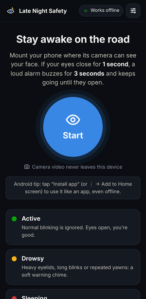
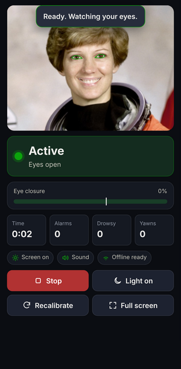
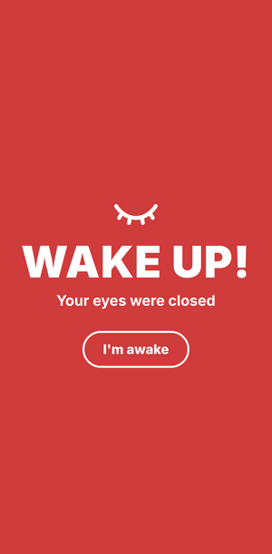
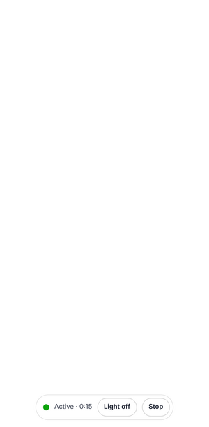
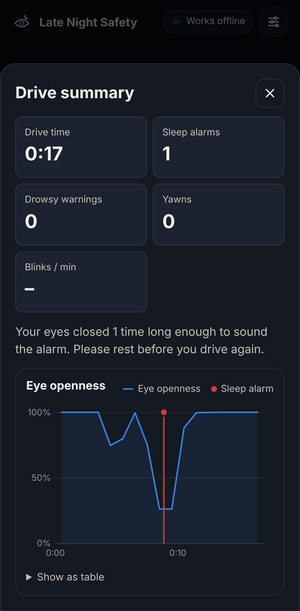

# Late Night Safety

A drowsiness alarm for people who have to stay awake: late-night drivers, night-shift workers, students pulling an all-nighter. Mount your phone (or sit at your laptop) so the camera can see your face. If your eyes **stay closed** (not a normal blink), a loud alarm buzzes for 3 seconds and keeps going until they open.

It runs on **Android phones** (as an installable app or an APK), **iPhones**, and **laptops** in the browser, and it **works offline**: after you open it once with internet, it keeps working with no signal at all.

| Start | Monitoring | Alarm | Night light | Drive summary |
| --- | --- | --- | --- | --- |
|  |  |  |  |  |

*(The face is a public-domain NASA portrait used by the automated tests.)*

## Features

- **Sleeping alarm.** Eyes closed for 1 second (adjustable, 0.5–3 s): loud 3-second buzz + vibration + flashing red/white screen. It repeats while your eyes stay shut. Normal blinks are ignored.
- **Drowsy warning.** Earlier signs of tiredness get a soft chime instead: heavy, drooping eyelids, eyes closed a large share of the last minute (PERCLOS), repeated long blinks, or repeated yawns.
- **Yawn detection.** Mouth held wide open counts as a yawn. Three yawns in 10 minutes trigger a drowsy warning. Eyes that close *during* a yawn get a little extra time, so a big yawn doesn't set off the alarm.
- **Night light.** When it's too dark for the camera to see your face, the screen turns white to light it up, then stays on so the face isn't lost again. In the Android app it also raises screen brightness to 100%. Can be set to Auto, Always or Off.
- **Screen stays on.** When you press Start, a checklist asks for the camera, keep-screen-on and sound. Afterwards the screen won't sleep or lock while monitoring is on.
- **Works offline.** The app, the face-tracking engine and the face model (~15 MB) are saved on the device the first time you open it. The top bar shows "Works offline" when it's ready.
- **Private.** The camera picture is processed on your device and never uploaded. The page is locked so it can't contact any server (`connect-src 'self'`).
- **Drive summary.** When you stop, you see the drive time, the alarms, drowsy warnings, yawns and blink rate, plus a chart of eye openness over the drive.
- **Take-a-break warning** after two sleep alarms within 15 minutes.

## Getting the app

### Android

**Option 1: install from Chrome (easiest).** Open the website (see below) in Chrome, then tap **Install app** in the top bar (or ⋮ → *Add to Home screen*). It gets its own icon, opens full screen and works offline.

**Option 2: the APK.** Every push builds an Android APK with GitHub Actions:

1. Open the repository's **Actions** tab → **Android app** → the latest successful run.
2. Download **late-night-safety-apk** under *Artifacts* and unzip it.
3. Copy `late-night-safety.apk` to your phone and open it. Android asks you to allow installing apps from that source the first time.

To publish an APK on the **Releases** page instead, push a version tag:

```bash
git tag v1.0.0
```

```bash
git push origin v1.0.0
```

The APK is a debug build: fine for sideloading on your own phones. The Play Store needs a signed release build (Android Studio → *Build → Generate Signed App Bundle*).

### iPhone

Open the website in Safari → Share → **Add to Home Screen**. (Safari's camera, sound and keep-screen-on support are less complete than Android's. Test the alarm sound with your phone's Silent switch first.)

### Laptop

Open the website in Chrome, Edge, Firefox or Safari. Keep the window visible: browsers pause the camera when a window is minimised.

### Publishing the website (one-time setup)

The website is hosted free on GitHub Pages:

1. Repository **Settings → Pages → Source: GitHub Actions**.
2. **Actions → Website → Run workflow** (it also runs automatically on every push to `main`).
3. The site appears at `https://<your-user>.github.io/late-night-safety/`.

The camera only works over `https://` (or on `localhost`), which GitHub Pages provides.

## Using it

1. Put the phone on a dashboard mount, front camera facing you, about an arm's length away. Plug in a charger.
2. Turn the media volume up. Press **Start**, then **Allow & start** in the checklist. Use **Test** to hear the alarm.
3. Look ahead with your eyes open for 2 seconds while it calibrates to your eyes.
4. Drive. The status shows **Active**, **Drowsy** or **Sleeping!**. Tap the alarm screen (or *I'm awake*) to silence it early.
5. Press **Stop** to see the drive summary.

Keep the app on screen while driving. Phones pause the camera for apps in the background. On Android you can use split screen with your maps app.

### Settings

| Setting | Default | What it does |
| --- | --- | --- |
| Eyes closed for | 1.0 s | How long the eyes must stay shut before the alarm |
| Alarm length | 3 s | Repeats while the eyes stay shut |
| Volume / Vibrate | 100% / on | |
| Sensitivity | Normal | *High* also treats half-closed eyes as closed; *Low* needs fully shut eyes |
| Drowsy warning chime | on | Soft chime for early signs |
| Count yawns | on | |
| Alarm if face not visible | Off | Optional alarm if your face disappears for 3–10 s |
| Night light | Auto | Auto / Always / Off, with 100% / 70% / 40% strength |
| Camera, preview, mirror | Front | |
| Use GPU | on | Turn off if tracking misbehaves on your phone |

Settings are saved on the device.

## How it works

1. **Face tracking:** [MediaPipe Face Landmarker](https://developers.google.com/mediapipe/solutions/vision/face_landmarker) finds 478 points on your face plus "blendshape" scores (`eyeBlinkLeft/Right`, `jawOpen`) for every camera frame, about 24 times a second. It runs in WebAssembly on the device (GPU when available).
2. **Eye closure:** two signals are combined:
   - the **Eye Aspect Ratio**: the gap between the eyelids divided by the eye's width;
   - the blink scores.

   Both are compared with a 2-second calibration of *your* open eyes, so narrow or wide eyes work equally well.
3. **Timing in milliseconds, not frames:** the alarm fires when the eyes have been closed for 1 s of real time, whatever the frame rate. The open/closed thresholds overlap so the state doesn't flicker.
4. **Drowsiness signs:**
   - **PERCLOS:** the share of the last 60 s the eyes were closed;
   - **heavy eyelids:** partly closed for 4 s;
   - **long blinks:** 0.4–1 s;
   - **yawns:** Mouth Aspect Ratio + `jawOpen`, mouth wide open for 1.5 s.
5. **Night light:** if no face is found and the picture is dark (average brightness < 70/255) for ~1 s, the screen turns white.

This project was inspired by [MartinaJohn/Driver-Drowsiness-Detection-Web-App](https://github.com/MartinaJohn/Driver-Drowsiness-Detection-Web-App) (Python + dlib on a server). This version keeps its three levels (Active / Drowsy / Sleeping), yawn detection and EAR/MAR chart, and changes how they run:

| | Reference project | This app |
| --- | --- | --- |
| Where it runs | Python server with OpenCV/dlib; it opens the server's webcam, so it can't run on a phone | Entirely in the phone or laptop browser, or the Android app |
| Thresholds | Fixed (EAR 0.25 / 0.18) | Calibrated to each person |
| Timing | Frame counts (depends on the frame rate) | Milliseconds |
| Offline / phone | Needs the server; desktop only | Works offline; Android, iPhone, laptop |
| Dark conditions | Not handled | White night light |

## Limitations and safety

- **This is a safety aid, not a substitute for sleep.** If you feel drowsy, stop somewhere safe and rest. A 20-minute nap helps.
- The alarm fires about 1 second after your eyes close, plus one or two camera frames. Slow phones running in CPU mode react a little later.
- Sunglasses, or glasses that block infrared or reflect strongly, can hide your eyes from the camera.
- Phones pause the camera when the app goes to the background or the screen locks. The app keeps the screen on, but you have to keep it in front.
- The white night light is bright. Lower its strength in Settings if it's too much.
- iPhone: web apps have limited control over sound. The app asks iOS to play the alarm even in Silent mode, but test it on your phone.

## Development

There's no build step for the web app: the files in this folder are the app.

```bash
npm start
```

That serves the app at <http://localhost:8080> (the camera works on `localhost`).

```bash
npm test
```

That runs the unit tests (detection logic, night light, offline file list) with Node's built-in test runner.

```bash
npm run test:e2e
```

That's the end-to-end test in Chromium with the real face tracker. It needs the `playwright` package and its Chromium. It drives the app with a recorded face (eyes open/closed), online and offline. Set `SCREENSHOTS=<folder>` to save screenshots.

Android app (needs Android Studio, or a JDK 21 + Android SDK):

```bash
npm ci
```

```bash
npm run android:sync
```

```bash
npm run android:open
```

`android:sync` copies the web app into `android/`. `android:open` opens the project in Android Studio, where you can build and run it.

Project layout:

```
index.html, css/, js/        the web app
  js/drowsiness.js           detection logic: eye/mouth metrics, calibration, levels (unit tested)
  js/night-light.js          when to show the white screen (unit tested)
  js/detector.js             MediaPipe wrapper
  js/alarm.js                synthesised alarm/chime (Web Audio) + vibration
  js/screen-awake.js         keep-screen-on (native, Wake Lock API, or video fallback)
  js/app.js                  UI controller
sw.js                        service worker: offline support
vendor/mediapipe/            face tracking engine + model (served locally, see SHA256SUMS)
android/                     Capacitor Android project (+ ScreenControlPlugin.java)
tests/unit, tests/e2e        tests
scripts/                     dev server, web build, vendoring script
.github/workflows/           APK build, website deploy
```

**Updating:** when you change any file, bump `VERSION` in `sw.js` so installed copies download the new version. They show "Update ready" in the top bar. If you add a file, add it to `ASSETS` in `sw.js`; `npm test` checks this.

**MediaPipe version:** `scripts/vendor-mediapipe.sh` re-downloads the engine and model and checks their checksums. It is pinned to `@mediapipe/tasks-vision` **0.10.35** on purpose: newer 1.x releases send usage metrics to Google, which this app avoids.

## Credits

- Face tracking: [MediaPipe](https://github.com/google-ai-edge/mediapipe) by Google, Apache License 2.0 (`vendor/mediapipe/LICENSE`).
- Test photo in `tests/e2e/fixtures`: NASA portrait of astronaut Eileen Collins (public domain), from scikit-image's sample data. The "eyes closed" version is edited for testing.
- Idea and feature set inspired by [MartinaJohn/Driver-Drowsiness-Detection-Web-App](https://github.com/MartinaJohn/Driver-Drowsiness-Detection-Web-App).
